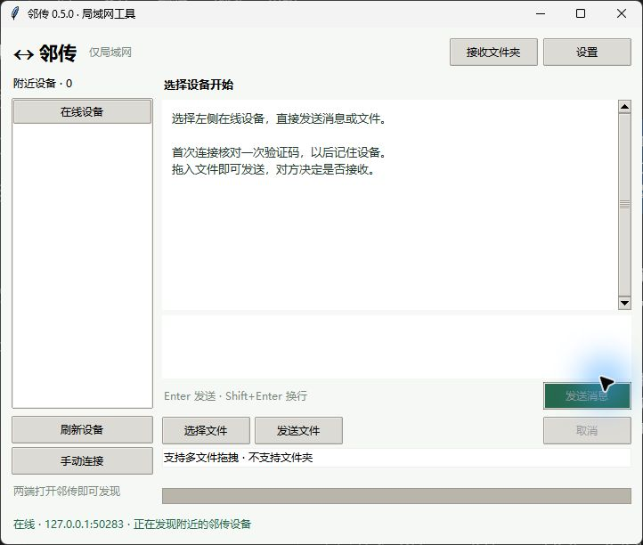

# 邻传 · 个人局域网工具

**0.5.0 · 2026-10-11**。Windows 独立 EXE，约 16 MiB，免安装。两台电脑各自打开 App，自动显示正在运行邻传的设备；选择设备即可双向聊天和传文件，不需要浏览器。

- 默认 720×580 窗口：左侧设备，右侧聊天；设置收进单独窗口。
- 在线直聊：首次连接核对一次验证码并记住设备；以后 Enter 直接发送，Shift+Enter 换行。
- 文件：选择文件后点击发送，或拖入窗口立即发起请求；只由接收方确认，支持拒绝和中途取消。
- HTTPS 直传、精确证书 pin 和 SHA-256 文件核对；不使用公网中继、代理或遥测。
- 聊天显示 → 输入框 → 文件工具，操作集中；无需点击开始或结束聊天。
- 设置 → 软件更新 · GitHub：主动检查版本、下载 SHA-256 校验后的更新包。



## 使用

完整解压便携包到可写目录 → 双击 `邻传.exe` → 等待设备出现 → 选择设备。
聊天直接输入文字发送；文件点击“选择文件 / 发送文件”，或拖入文件。首次通过可信方式核对验证码并记住设备；后续聊天自动连接，文件只由接收方决定。文件保存在 EXE 旁 `邻传数据/received`，顶部按钮可打开。仅给 Windows 专用网络放行防火墙。

[完整使用说明](docs/USAGE.md) · [自己修改与打包](docs/DEVELOPMENT.md) · [版本记录](CHANGELOG.md) · [验证记录](docs/VALIDATION.json)

公开仓库：[powersqb/lindrop](https://github.com/powersqb/lindrop) · [下载正式版本](https://github.com/powersqb/lindrop/releases)

## 源码与升级

本目录是独立 Git 仓库，已保存 0.2.0 基线与后续版本。源码在 `lan_drop/`，入口 `__main__.py`；布局在 `layout.py`，聊天和文件协议独立，适合后续增加局域网功能。依赖由 `pyproject.toml` 与 `uv.lock` 固定，不混用工程分析环境。

```powershell
uv sync --locked
uv run --locked python -m lan_drop
# 修改后验证
uv run --locked ruff check .
New-Item -ItemType Directory -Force outputs | Out-Null
uv run --locked pytest -q --basetemp=outputs/test-temp
# Windows 单文件 EXE
& .\scripts\Build-LanDrop.ps1
```

源码运行需要 Git 自带 OpenSSL 或 PATH 中的 openssl.exe；独立 EXE 已捆绑所需运行库。开发安装依赖需要联网，聊天和传文件只使用局域网；主动检查或下载软件更新才访问 GitHub。详见工具链说明。

## 当前边界

只显示运行邻传的设备。单文件 ≤2 GiB，每批 ≤50 个文件、总量 ≤20 GiB。仅支持普通文件，目录请先压缩。聊天仅在内存中缓存，关闭清空；单条 ≤4 KiB，内部连接最多 1 小时，到期后下一次发送自动重连，无离线消息。暂停恢复、远程控制、剪贴板同步暂未实现。

发现消息与设备名不代表可信身份，首次必须核对验证码。证书和设备信任保存在本地，重启后仍有效；证书变化会阻止连接。接收文件不会自动共享。IPv4 限制为私有地址或本机；访客 Wi-Fi、客户端隔离、跨 VLAN、VPN 多网卡可能影响发现和连接。此版本的新交互要求两端都升级至 0.5.0；旧版没有自动直聊能力。

测试不等同所有网络环境均可用；第二台物理电脑验证仍待完成。
