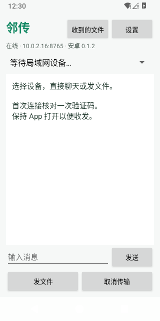

# 邻传 Android 0.1.2（测试版）

Java 原生界面，Android 8+，无第三方运行依赖。用户指定 Mate 80 / HarmonyOS 7，在卓易通内的真实兼容性待用户验证；不等同鸿蒙原生应用。

个人签名 APK：[GitHub 测试版下载](https://github.com/powersqb/lindrop/releases/tag/android-v0.1.2)。0.1.2 已通过 10 项协议与接收存储单元测试、Android Lint、双向 Windows 协议互通，以及 Android 35 模拟器启动/Keystore/TLS 验证，详见 [验证记录](../docs/ANDROID-VALIDATION.json)。



## 使用

1. 将 `lindrop-android.apk` 传到手机，按系统提供的方式安装。HarmonyOS 5+ APK 安装请参照 [华为说明](https://consumer.huawei.com/cn/support/content/zh-cn16061787/)，以兼容环境实际支持为准。
2. 电脑打开邻传 0.6.1 或更新版本，手机连接同一 Wi-Fi 并打开邻传；保持 App 在前台使用。
3. 在设备下拉框选电脑，直接输入文字或点击“发文件”；首次双方核对验证码并确认，后续聊天无需开始/结束。
4. 文件只由接收端确认；存在同名文件时提示是否覆盖。取消传输可停止正在发送、等待或接收的文件任务。
5. 接收文件先保存到 App 私有目录，点击顶部“收到的文件”选择文件，保存到手机文件管理。导出检查保存位置给出的文件名，不允许悄悄改名；内容逐字节复制。卸载会删除私有文件，重要文件先导出。
6. 没发现设备时，设置 → 手动连接，填写电脑界面上的 `IPv4:端口`。兼容环境必须允许电脑反向连接手机的 TLS 端口，否则手动连接也无法完成验证。

手机网络变化后可在设置中“重试网络连接”。无后台保活服务，不承诺锁屏继续接收；聊天只缓存在内存，单条最多 4 KiB。单文件最多 2 GiB，每批最多 50 个、总量最多 20 GiB；发送时使用私有临时缓存，需足够空间。Windows 不兼容的文件名会拒绝并提示，不能通过静默改名发送。手机端仅使用 LAN，不自动访问 GitHub或检查更新。

## 修改与构建

`app/src/main/java/cn/lindrop/app/`：

| 文件 | 职责 |
| --- | --- |
| MainActivity.java | 原生控件布局、系统文件选择/导出、确认对话框；UI 更新只在主线程 |
| Identity.java | Android Keystore P-256 身份、TLS 服务端/客户端上下文 |
| Protocol.java | 局域网、文件名、大小、文本校验及验证码 |
| Wire.java | 限长 HTTP/1.1、TLS 证书精确 pin；无代理或重定向 |
| Node.java | 发现、双向连接、信任、聊天和文件协议；后台线程与容量限制 |

固定工具版本：JDK 17、Gradle 8.11.1、AGP 8.9.2、SDK 35 / Build Tools 35.0.0。Gradle Wrapper 校验官方分发包 SHA-256。JVM 测试依赖 JUnit 4.13.2 / org.json 20250517，只用于测试，不进入 APK。Java 格式使用 google-java-format 1.25.2。

工程根目录已有工具时，从邻传仓库运行：

```powershell
& .\scripts\Build-Android.ps1
# 自己的 SDK / JDK：
& .\scripts\Build-Android.ps1 -JdkHome C:\Tools\jdk-17 -SdkRoot C:\Tools\android-sdk
```

脚本输出 `outputs/android/lindrop-android.apk`。中文 Windows 路径可能使 Gradle 测试子进程找不到类，脚本自动复制少量源码到 TEMP ASCII 路径构建，路径写入 `outputs/android/build-directory.txt`，可查看测试与 Lint 报告。构建不会改变源文件。工具安装用 [官方 SDK](https://developer.android.com/studio#command-tools)、[Temurin](https://adoptium.net/temurin/releases/?version=17)；需要 SDK platform 35、build-tools 35.0.0。

标准命令（Android Studio 或 ASCII 路径）为 `gradlew assembleDebug assembleDebugAndroidTest testDebugUnitTest lintDebug`。`scripts/Test-AndroidInterop.py` 提供与现有电脑端的实际 TLS 互通测试；`interop/JvmHarness.java` 使用相同通信源码，但不能代替 Android Keystore 和 UI 验证。GitHub Android 工作流另用真实 Android 模拟器运行 SmokeInstrumentation。

## 签名与升级

本地 `outputs/android-signing/lindrop.jks` 和 `password.txt` 仅授权当前 Windows 用户 / SYSTEM 访问，被 Git 忽略。**将整个签名目录安全备份到个人离线存储**；丢失密钥后无法覆盖升级旧 APK。不要上传密钥、密码、设备证书或接收文件。

以后修改版本时递增 `app/build.gradle` 的 `versionCode` 并更新 `versionName`、界面显示与文档。使用同一签名生成新 APK，即可由安卓安装器覆盖安装并保留 App 数据。首版没有 App 内自动更新；GitHub 自动构建产物为 debug 测试包，与本地个人签名不同，不应用 debug 包覆盖个人发布包。

安卓标签采用 `android-v0.1.0` 等前缀；测试版发布为 prerelease，不替换 Windows 的 latest 发布，避免影响电脑端更新。

## Mate 80 真机反馈（2026-10-11）

卓易通安装运行、手动连接电脑、文字聊天和手机发电脑已由用户确认。电脑收到的手机 UDP 广播源地址被改写为电脑自身；请将 Windows 邻传升级至 0.6.1，手机手动连接电脑后先发送文字建立已验证的聊天，再从电脑发文件。此方向待更新后用户复测。手机 APK 无需重装。

## 0.1.1 接收修复

新文件提交改用同目录移动，避免兼容环境不支持硬链接导致收完后保存失败。保留原名、内容校验与同名确认；失败在手机端明确显示。顶部新增“收到的文件”入口，设置中也可打开。点击文件后通过系统保存对话框导出到下载等目录；私有目录不会直接出现在普通文件管理中。0.1.1 使用与 0.1.0 相同的个人签名，可覆盖安装；不要卸载，以保留文件与设备身份。

## 已连接电脑自动查找（0.1.2）

升级后先手动连接现有电脑一次；只有设备 ID 与已核对的原证书一致才保存地址（最多 16 台）。随后关闭并重新打开手机邻传，电脑在线且地址不变时，会自动验证并显示在设备列表中，不用再次输入地址。忘记设备同时清除该地址。新电脑第一次仍需手动连接并核对，电脑 IP/端口变化也需要手动刷新地址；自动查找不扫描网段、不访问公网、不发送聊天或文件。两端保持 App 打开。
